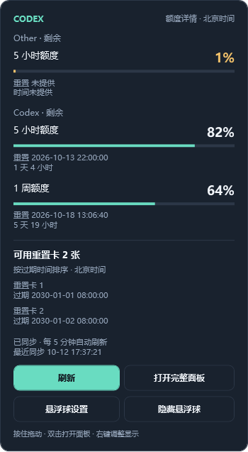
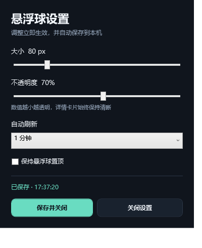

# Codex Usage Panel · Codex 用量面板

轻量 Windows 用量工具：悬浮球直接显示 **5 小时和周额度的剩余百分比**，鼠标移上查看额度详情、重置倒计时和重置卡。支持托盘驻留，运行时无需打开 ChatGPT / Codex 桌面客户端窗口。

独立社区项目，与 OpenAI 无隶属关系。采用 [MIT 许可证](LICENSE)。

源码仓库：[willzdragonv-del/codex-usage-panel](https://github.com/willzdragonv-del/codex-usage-panel)。

## 功能与预览

- 可拖动悬浮球；大小、透明度、置顶和刷新频率均可调整并自动保存。
- 悬停展开详情，鼠标移入卡片可查看、刷新或打开完整面板；移开自动收起。
- 显示所有接口提供的额度窗口、剩余比例、重置时间和倒计时。
- 显示可用重置卡数量、名称和到期时间；缺失明细时明确提示。
- 刷新可选快速（15 秒轮询）、1、2、5、10 分钟，默认 5 分钟；连续失败按 10 / 20 / 30 分钟退避。
- 支持隐藏、托盘恢复和单实例；不自动消耗重置卡。

| 悬浮球 | 悬停详情 |
| --- | --- |
|  |  |

截图使用固定演示数据，不含真实账号信息。

## 运行要求

| 项目 | 要求 |
| --- | --- |
| 平台 | Windows x64 桌面环境 |
| Codex | 原生 `codex.exe`，支持 `app-server --listen stdio://` |
| 账号 | 通过 Codex 登录的 ChatGPT 账号；仅 API Key 不能查询套餐额度 |
| 网络 | 可以访问账号认证及 Codex 服务 |
| 普通发布包 | [.NET 10 Desktop Runtime x64](https://dotnet.microsoft.com/download/dotnet/10.0) |
| 自包含包 | 自带 .NET 环境，仍需单独安装 Codex |

Codex 安装和登录参考 [官方 CLI 文档](https://learn.chatgpt.com/docs/codex/cli)。只有 `codex.cmd` 包装脚本时，需找到对应的原生 `codex.exe` 并手动选择。

## 快速使用

1. 双击发布包中的 `CodexUsage.exe`；从源码构建时位于 `dist\CodexUsage.exe`。
2. 球上“5h”为 5 小时剩余额度，“周”为周剩余额度；“—”表示未取得或未提供。
3. 悬停看详情，按住左键拖动，双击打开完整面板。
4. **右键球 → 悬浮球设置**，或点击详情中的“悬浮球设置”，打开独立设置窗口，调整大小、不透明度、刷新频率及置顶。
5. 隐藏后从托盘右键“显示悬浮球”恢复；双击托盘打开完整面板。
6. 未找到 Codex 时在完整面板点击“选择 Codex”；未登录时点击“登录账号”，在浏览器完成操作。
7. 完全退出使用悬浮球或托盘右键“退出”。完整面板的置顶与球的置顶独立控制。

自动发现顺序为手动配置的有效路径、PATH 中的 `codex.exe`、`%LOCALAPPDATA%\OpenAI\Codex\bin` 下最近修改的 exe。

## 配置

文件位于 `%LOCALAPPDATA%\CodexUsagePanel\settings.json`。推荐界面调整；手动编辑前先退出程序。

```json
{
  "codexPath": null,
  "ballSize": 88,
  "ballOpacity": 1,
  "ballTopmost": true,
  "refreshIntervalSeconds": 300
}
```

| 配置 | 默认值 | 含义 |
| --- | --- | --- |
| `codexPath` | `null` | 自动发现，或指定原生 exe 完整路径 |
| `ballSize` | `88` | 球直径，64–144 逻辑像素，界面步长 8 |
| `ballOpacity` | `1` | 0.35–1，越小越透明；详情保持清晰 |
| `ballTopmost` | `true` | 是否始终置顶 |
| `refreshIntervalSeconds` | `300` | 15、60、120、300、600 秒；快速档为轮询 |

停止调整约 350 毫秒后自动保存，窗口显示“已保存”和时间。“保存并关闭”立即保存后关闭设置；保存失败时提示并保留窗口。“关闭设置”及右上角关闭会尝试保存并收起设置，程序继续运行。退出程序会再次尝试保存尚未保存的改动。



旧配置使用默认值；损坏配置回退默认，越界显示数值限制在可用范围，非法刷新值回退 300 秒。北京时间、位置和隐藏状态目前不支持配置或持久化。详见 [配置与排查](docs/CONFIGURATION.md)。

## 构建与测试

需要 Windows、PowerShell、.NET 10 SDK。无需 Node.js 或 Python，无第三方 NuGet 运行依赖。

```powershell
# 离线测试并发布普通 x64 单文件程序
.\build.ps1
# 或自带 .NET 环境
.\build.ps1 -SelfContained
# 运行
.\dist\CodexUsage.exe
```

目标程序正在运行时请先托盘退出，避免文件占用。脚本优先使用本地 `.tools\dotnet`，否则使用 PATH 中的 dotnet。

```powershell
# 离线行为测试
dotnet run --project tests/CodexUsage.Tests -c Release
# 离线 WPF 测试，含显示设置与持久化
dotnet run --project tests/CodexUsage.Smoke -c Release -- --floating
# 可选真实账号查询，需要 Codex、登录和网络
dotnet run --project tests/CodexUsage.Tests -c Release -- --live
# 可选真实账号 UI 验证及截图
dotnet run --project tests/CodexUsage.Smoke -c Release -- artifacts
```

`build.ps1` 执行前两项离线测试。测试使用 console runner，**不使用 dotnet test**。WPF 测试需要桌面会话。真实账号测试可能输出个人路径、卡片信息或生成含个人信息的截图，产物不应直接公开。

## 实现、隐私与限制

通过独立 `codex app-server` 子进程和 stdio JSONL 完成握手、账号、用量及登录操作；不依赖客户端内置工具，不调用模型生成回答。参考 [官方 App Server 文档](https://learn.chatgpt.com/docs/app-server)。

用量读取不是模型生成请求，正常不会消耗模型套餐额度；这是根据所调用接口性质作出的判断，上游并未在该文档承诺此工具任何刷新频率均无请求限制。每轮有进程启动和网络开销，快速档并非服务端实时推送；通常建议 1 分钟。计时从上一轮完成后开始，不会重叠发起轮询，实际更新速度也受网络及服务端数据延迟影响。

每轮查询后释放查询进程，登录回调保留到完成、取消或约 5 分钟超时。退出只清理本工具创建的进程。

本工具不保存令牌、密码、原始协议日志或用量历史，不提供遥测；Codex 自己负责凭证管理。设置仅保存程序路径及显示偏好，最近一次用量只存在于会话内存。

剩余比例不代表固定消息次数；周窗口按接口报告的时长和重置时间展示。不同账号可能没有卡片、没有明细或某个额度窗口。混合 DPI 多显示器的实际拖动尚未完成人工验收。

## 项目结构

```text
src/CodexUsage.Core/       解析、时间、协议客户端、刷新和登录状态
src/CodexUsage.Desktop/    WPF 面板、悬浮球、托盘、配置与轮询
tests/CodexUsage.Tests/    行为及真实子进程协议测试
tests/CodexUsage.Smoke/    确定性 WPF 与可选真实账号验证
docs/                     配置说明、发布指南和演示图
build.ps1                 测试与发布
package-source.ps1        白名单源码打包
```

见 [贡献说明](CONTRIBUTING.md)、[变更记录](CHANGELOG.md)、[发布指南](docs/PUBLISHING.md)。MIT 许可适用于本项目源码，不包含 Codex、.NET 等独立软件的授权。
